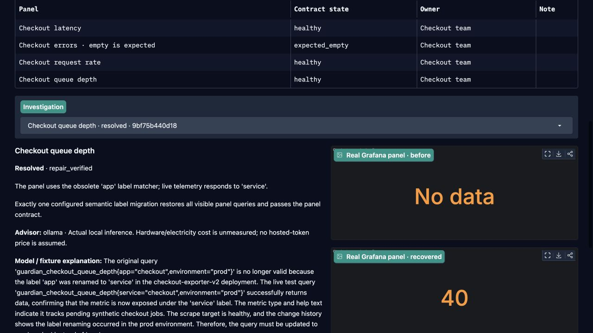
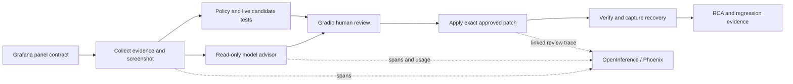
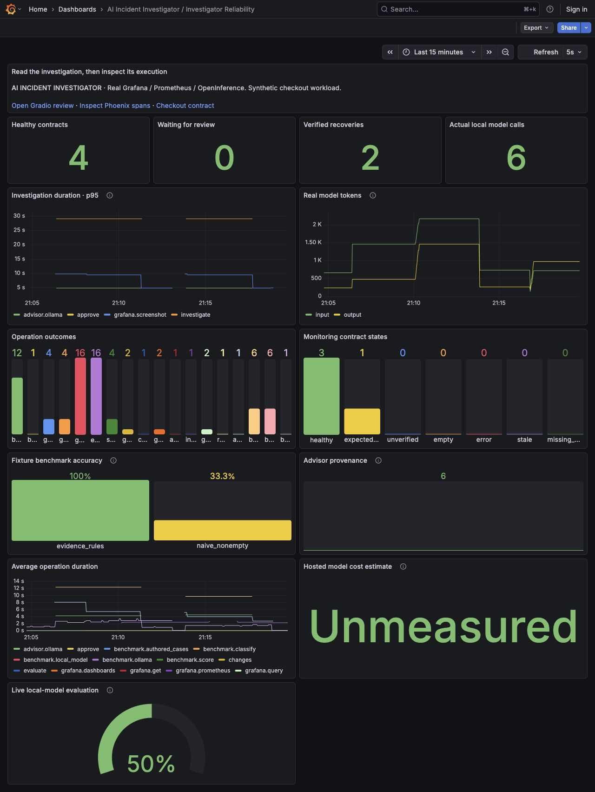

# AI Incident Investigator

**Find the evidence behind a broken Grafana panel—and inspect the AI that investigates it.**

A working Python lab with **Gradio, Grafana, Prometheus, OpenInference, Phoenix and optional local Ollama inference**. Simulate a metric-label migration, inspect real query results and screenshots, review an exact repair, verify recovery and retain a root-cause report.

[Recorded walkthrough](https://sivalinb.github.io/ai-incident-investigator/) · [Full workflow](docs/WORKFLOW.md) · [Architecture](docs/ARCHITECTURE.md) · [Telemetry reference](docs/TELEMETRY.md) · [Evaluation methodology](docs/EVALUATIONS.md) · [Validation evidence](docs/VALIDATION.md)



## What is real?

| Component | Execution |
| --- | --- |
| Grafana and Prometheus | Real services, queries, dashboard revisions and saved repairs |
| OpenInference / OpenTelemetry | Real SDK spans, OTLP export, trace IDs and linked review traces |
| Phoenix | Real local trace backend and UI |
| Gradio | Working investigation, review, trace, evaluation and RCA workspace |
| Checkout workload and fault | Explicitly synthetic exporter and controlled `app → service` migration |
| Default advisor | Authored offline fixture, labeled `CHAIN`; no LLM or token usage |
| Optional Ollama advisor | Actual local model call, `LLM` span, provider-reported tokens and measured timings |
| Evaluation | Six transparent authored cases; live local-model results recorded separately |

The public walkthrough replays saved evidence. **It is not a hosted Gradio or model endpoint.** The live services run locally.

## Run locally

Requirements: Python **3.12**, Node **20+**, macOS or Linux. The initial launch needs internet to install dependencies and download verified Grafana/Prometheus binaries. A GPU is not required for the offline workflow.

```bash
git clone https://github.com/sivalinb/ai-incident-investigator.git
cd ai-incident-investigator
python3.12 -m venv .venv
source .venv/bin/activate
pip install -r requirements.txt
npm ci --registry=https://registry.npmjs.org
npx playwright install chromium
python scripts/demo.py
```

The panel screenshot helper can also use an installed macOS Google Chrome, or `CHROME_EXECUTABLE`. It launches an isolated headless browser with no user profile.

| Open | URL |
| --- | --- |
| **Gradio investigation lab** | http://127.0.0.1:7868 |
| **Grafana investigator reliability** | http://127.0.0.1:3015/d/incident-investigator |
| Checkout dashboard under test | http://127.0.0.1:3015/d/guardian-checkout |
| **Phoenix traces** | http://127.0.0.1:6008 |
| Prometheus | http://127.0.0.1:9095 |

The native launcher supervises its five processes. **Ctrl+C stops the stack.** It refuses to replace an occupied service. Local runtime files and SQLite databases stay in ignored `.runtime/`. Reusing installed binaries is supported with `--grafana-home` and `--prometheus-bin`.

### Use an existing local Ollama model

Start your existing Ollama server and choose an installed model with `ollama list`. Then launch:

```bash
export OI_ADVISOR_MODE=ollama
export OLLAMA_URL=http://127.0.0.1:11434
export OLLAMA_MODEL=your-installed-model
python scripts/demo.py
```

The native `/api/chat` integration requests structured JSON, validates evidence references and records actual `prompt_eval_count` and `eval_count`. It withholds the rule diagnosis from the local model. Model suggestions stay advisory. Local compute cost is **unmeasured**, not reported as a zero-dollar total.

For the hosted Responses API option, see [Operations](docs/OPERATIONS.md). No API key is needed for Ollama or the offline workflow.

### Docker alternative

```bash
docker compose up --build -d
```

Open the same Gradio/Grafana/Phoenix URLs. The Compose stack defaults to the offline fixture. All published ports bind to loopback. Configure an existing host Ollama endpoint as documented in [Operations](docs/OPERATIONS.md). Stop with `docker compose down`.

## Walk through the working demo

1. **Scan contracts.** Three panels contain data; an error-events panel is deliberately allowed to be empty.
2. **Simulate label migration.** The synthetic exporter changes `app="checkout"` to `service="checkout"`. The queue panel loses its current data.
3. **Inspect the investigation.** Review the actual failing screenshot, query results, scrape health, change context, model/fixture explanation and tested candidate.
4. **Inspect the trace.** The Trace explorer shows nested operations and measured durations. Phoenix exposes the OpenInference attributes and actual model usage.
5. **Approve the exact repair.** The proposal hash binds the query, panel, context, contract and dashboard revision. Intervening edits invalidate approval.
6. **Verify recovery.** The engine rechecks the candidate, saves the one approved query change, performs three current evaluations, captures recovery and records an RCA.
7. **Compare evaluations.** Run the authored benchmark, then the optional six-call local-model benchmark. Their provenance and measurements remain separate.

You can reject the proposal or repair the dashboard yourself and choose **Verify manual fix**. There is no unrestricted model write tool.



## Grafana demonstration

Two dashboards connect **what failed** with **how the investigation behaved**. The investigator dashboard includes contract health, pending reviews, verified recoveries, operation latency, operation outcomes, real model tokens, advisor provenance and separate fixture/live evaluation scores. Dollar estimates only appear for a hosted call with explicitly configured rates.



## Validate and reproduce

```bash
PYTEST_DISABLE_PLUGIN_AUTOLOAD=1 python -m pytest -q
# With the demo running; this resets only the synthetic checkout demo:
python scripts/verify.py
```

The integration verifier uses the local demo API with an explicit synthetic-workflow header. It applies an exact proposal as the named **integration reviewer**, not as a production human approver. It checks real before/after panel captures, recovery, query scope and the link between investigation and review traces.

See [Validation](docs/VALIDATION.md) for recorded results and [evaluations](docs/EVALUATIONS.md) for what the small benchmark can establish. CI runs unit tests and the Compose integration workflow; its badge/run status is the authoritative current CI result.

## Project map

| Directory | Responsibility |
| --- | --- |
| `investigator/` | Gradio UI, OpenInference telemetry, Ollama and benchmark scoring |
| `guardian/` | Dashboard contracts, evidence collection, exact approvals, repair verification and persistence |
| `demo/` | Synthetic exporter, checkout dashboard and local contract configuration |
| `observability/` | Generated Grafana dashboard and Prometheus configuration |
| `scripts/` | Native/container startup, bootstrap, screenshot helper and integration verification |
| `docs/` | Workflow, architecture, telemetry, evaluation methodology, screenshots and recorded evidence |
| `site/` | Public static replay of recorded evidence; no live credentials or model service |

## Scope and provenance

This is a **local reliability lab**, not a production autonomous-remediation service. The Gradio workspace is restricted to the synthetic demo configuration. Its reviewer name is a local prototype identity, not team authentication. The repair core supports standard Prometheus-backed panel queries; unsupported transformations, repeated/library panels and ambiguous contexts are unverified.

The repair engine and its original regression tests build on [Siva Babu’s MIT-licensed Grafana Panel Agent](https://github.com/sivalinb/grafana-panel-agent). OpenInference instrumentation, local inference, evaluation, Gradio, dashboards and the recorded walkthrough are added here. Vendor projects retain their own licenses. This project’s original code is MIT licensed.
