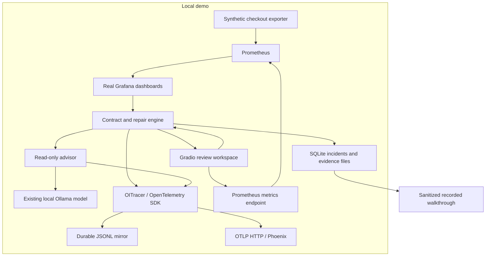

# Architecture and engineering decisions

## Components

`guardian` owns the operational workflow. `investigator` owns the user workspace, model transport, tracing and benchmark. The model cannot create an executable repair: only the repair engine’s configured semantic migration policy and live candidate tests can do that.

## State and concurrency

SQLite persists incidents, events, checks and scan summaries. A stable fingerprint groups failures for the same dashboard/panel/context. An `RLock` serializes scans, demo state changes and repair operations inside one app process. Gradio’s mutation callbacks also share one concurrency group. This is single-process coordination, not distributed locking.

The native supervisor owns five children: exporter, Prometheus, Grafana, Phoenix and Gradio. The model server is separately managed by the operator. Startup refuses occupied ports and shutdown terminates only owned child processes.

## Approval and verification

`awaiting_review → applying → verifying → resolved` is the successful path. Rejection, stale approval, verification failure and close/reset are explicit states. The exact proposal hash and Grafana’s revision checks guard against stale UI decisions and concurrent edits.

After a successful save, the engine compares the current dashboard hash on every verification. If recovery fails, it restores the original only when no intervening edit occurred. The model’s suggested query cannot override these checks.

## Trace boundaries

Each scan is a `CHAIN`; each investigation is an `AGENT` with tool and model children. Span IDs and timing come from the real SDK. The app uses `OITracer` and OpenInference kinds, not hand-authored trace IDs or simulated spans.

The JSONL mirror and Phoenix receive the same completed, masked spans. The JSONL exporter runs synchronously for inspectable local evidence; OTLP uses a bounded batch processor. Collector/export outages do not convert offline advisor data into live model data.

Review starts a new root trace after the human pause. An OpenTelemetry `Link` targets the earlier investigation span. Persisted incident/session metadata makes the relationship inspectable without inventing a continuous active span across human waiting time.

## Local inference and cost

The Ollama transport accepts local hosts only. It uses `/api/chat`, a JSON schema and deterministic sampling configuration. It records native usage and load/evaluation timings. Hardware cost, energy, amortization and total operating cost are unmeasured.

A separate hosted Responses API transport supports explicit input/output price assumptions. Its token-based estimate excludes infrastructure and other billing details. Unknown usage or absent rates stays unknown.

## Prototype boundary

The Gradio workspace is a local synthetic-demo application. A typed reviewer name is not authenticated enterprise identity. Production adoption requires individual authentication/authorization, durable audit retention, credential management, multiple-worker coordination, an explicit dashboard inventory/coverage contract and independent monitoring of the investigator itself.

The included standard panel adapter does not verify library/repeated panels, client transformations, arbitrary expression data sources or every possible dashboard-variable combination. Unsupported coverage remains visible as unverified.
